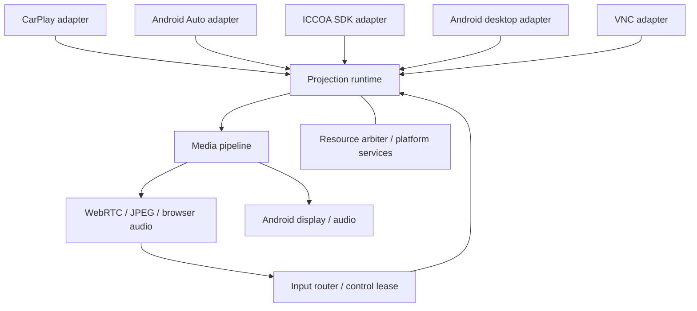

# 通用输入源框架设计草案

状态：以下保留研究时点的设计提案。当前已落地的代码和仍待验收的阶段见 [投影输入源实现说明](PROJECTION_IMPLEMENTATION.md)。核对日期：2026-10-21。

研究基线：WheelPlay `4ed3536822998babd086e4fcb1a384e791b0e2d4`；DiAuto `d53dad71e02e70340d968896140b1c601b38b917`；MiAuto `059b2bb6b4d7fd3b506e7c29bbf153a8e38a0c4d`。本次检查了源码和项目文档，没有构建外部项目或进行协议真机验证。下文区分已观察到的实现、设计建议和待验证能力。

## 1. 建议与范围

将 WheelPlay 定义为双向投影宿主：输入源提供画面、音频和状态，宿主返回触控、键盘、麦克风和控制请求。内部建议命名 `ProjectionSource`，避免与触摸输入设备的 `InputSource` 混淆。

采用「协议适配器 → 会话运行时 → 媒体与交互路由 → 输出端」架构。协议适配器拥有发现、认证、传输、协议状态机；运行时拥有活动源、资源仲裁、生命周期；媒体管线拥有共享编解码和输出选择；浏览器只依赖通用会话接口。

首版保持一个活动投影源、一个浏览器控制者。允许多个源被注册，不承诺多个无线协议同时广播或连接。先采用应用内模块和显式注册，不引入动态插件加载、跨进程帧 IPC 或全能协议总线。

## 2. 研究发现与架构约束

### WheelPlay

当前基础能力已经适合复用，但接口仍携带 CarPlay 语义：

| 证据位置 | 观察 | 设计影响 |
| --- | --- | --- |
| `common/.../web/WebSession.kt`，`TouchLease.kt` | 触控直接查找 `CarPlayBackgroundSession`；租约输入为 `AirPlayContact`，固定两个槽位 | 租约与协议编码分离；浏览器路由只捕获通用活动会话 |
| `shared/.../airplay/CarPlayMediaEngine.kt` 的 `MediaSink` | 同一接口含视频、RTP 音频、麦克风、iAP 消息、解密器创建 | 保留为 CarPlay 内部接口，外面增加适配层，不直接改名作为通用接口 |
| `shared/.../media/EncodedVideoSink.kt`，`CompressedVideoFrame.kt` | 已有压缩帧与 retain/close 约定；仍依赖 `airplay.VideoCodec`、整数 type 和解密密钥 | 提取中立媒体模型；保留缓冲区生命周期；解密服务留在 CarPlay 边界 |
| `common/.../web/WebVideoSource.kt` | 可配置 H.264/H.265 直通、请求关键帧，还创建 `NativeVideoDecoder(key)` | 拆开源侧解密、通用视频格式、浏览器输出协商 |
| `shared/.../media/AndroidMediaSink.kt` | WebRTC 已显示后可关闭本地解码；回退等待随机访问帧 | 保留该优化与恢复语义，不统一强制解码再编码 |
| `shared/.../web/OffscreenVideoOutput.kt` | Activity 无关的 SurfaceTexture/EGL/JPEG 输出 | 可演进为共享离屏画面入口；当前没有通用 Surface→WebRTC 编码链 |
| `common/.../CarPlayHostActivity.kt` 中 `CarPlayBackgroundSession` | 快照暴露 controller、sink、尺寸；已有所有者与停止完成回调 | 先用兼容适配器包装，逐步迁到通用运行时 |
| `common/.../WheelPlaySessionService.kt` | `WheelPlayBootstrap.ensure` 失败会停止 Web 服务和 CarPlay 会话 | 将 CarPlay 认证就绪检查下沉到 CarPlay provider；宿主/Web 自身检查独立保留 |
| `shared/.../media/CarPlayMediaSource.kt` | 实际是 Now Playing 和媒体命令接口，并非视频源 | 可演进成可选 `MediaControlPort`，不要把它当整个投影抽象 |

上述路径中，`CarPlayHostActivity.kt` 和 `WheelPlaySessionService.kt` 位于 `src/main/java/moe/feng/wheelplay`；其余 `...` 为 `src/main/java/com/shilapi/xcertplay`。

### DiAuto：适合提取协议栈，不适合整个应用作为库接入

项目提供 USB/无线 AA 接收，README 的已验证环境是 BYD DiLink 5.1 / Android 13。不能据此推定普通 Android 服务手机的网络能力和后台行为已经验证。

- `AapVideo.process()` 在分片组装完成后直接调用 `VideoDecoder.decode(...)`：这是引入 `EncodedVideoIngress` 的合适接缝，但须把配置参数、时间戳和完整访问单元整理清楚，不能把任意网络分片直接作为帧交给下游。
- `AapMessageHandlerType` 在视频/音频处理后发送协议 ACK。`AapControl` 的 `maxUnacked` 是消息窗口，不能把它误当完整帧数量，也不能将 ACK 绑定浏览器显示完成。
- `TouchEvent` 明确包含 pointer action、actionIndex、pointerId 和坐标。现有 CarPlay 两槽位快照不能无条件当作 AA 事件使用。
- `AapTransport.hasVideoSurface()` 和 `gainVideoFocus()` 与本地解码器、Activity 广播耦合。抽取时须改为投影输出就绪通知和语义焦点请求，否则纯压缩帧直通可能因没有本地 Surface 而无法启动。
- 主屏与仪表视频有不同 channel；音频、媒体状态、导航、传感器也是独立通道。因此从第一版就保留 `streamId` / `displayId`，UI 可以只开放主屏。

### MiAuto：公开部分是 SDK 集成层，不能视为完整开源 ICCOA 协议栈

- `app/libs/README.md` 明确说明 `icar-sdk.dex` 是不随仓库提供的第三方专有运行库；仓库仅有编译期签名存根。缺运行库也能构建成功，CI APK 没有 CarLink 能力。
- `IccoaManager` 通过 `UCarAdapter.startCast(surface, w, h)` 接入画面；公开桥接层没有压缩视频帧回调。`IcocaProjectionActivity` 的注释对解码职责表述不够清楚，应以实际 API 边界为准：宿主交入 Surface，内部处理细节待 SDK 验证。
- `IcocaBridge` 提供连接状态、PIN、导航与 Surface 绑定；所检查的 Activity/bridge/manager 没有形成可供 WheelPlay 使用的触控回传链路，不能宣称已验证交互完整。
- 配置中有 `setUseCustomAudioRecord(false)`，音乐、通话、音频焦点回调也有空实现。音频截取、麦克风注入与控制 API 需要单独确认，不能默认为可走浏览器路由。
- 集成文档明确禁用了继承自 AA 的 P2P/SoftAP 等副作用以避免争抢无线资源。框架不能仅靠“当前选择哪个源”来隔离资源。
- README 仅报告 Android 11 / arm64 Newland 设备完成一次 CarWith 会话；其他品牌手机、量产车机、仪表/HUD 均不能按成熟支持处理。
- 文档列出的特权权限并不意味着普通应用声明后就会获得；应在目标服务手机上检测实际权限和网络能力。

## 3. 分层与依赖方向



建议逻辑模块：`projection-api`、`projection-runtime`、`media-pipeline-android`、`output-browser`、`source-carplay`、`source-androidauto`、`source-iccoa`。VNC 与桌面模块在实际接入时增加。

先在现有 `common` / `shared` 内用 package 建边界，稳定后再拆 Gradle module，避免一次移动所有旧代码。`projection-api` 的基础数据模型不依赖 AirPlay、AAP、ICCOA、WebRTC 或 Android View；`Surface` 等平台接口放 Android 扩展层。应用组合层负责装配，输出模块不引用具体源。

## 4. 核心接口契约

以下是设计轮廓，不是可直接编译的实现，也不要求改写现有协议线程为协程：

```kotlin
interface ProjectionSourceProvider {
    val descriptor: SourceDescriptor
    suspend fun probe(host: HostCapabilities): SourceAvailability
    suspend fun open(request: OpenRequest, host: SourceHost): ProjectionSession
}

interface ProjectionSession {
    val id: SessionId
    val snapshot: StateFlow<SessionSnapshot>
    val input: InputPort
    val control: ControlPort
    suspend fun close(reason: CloseReason)
}

interface SourceHost {
    val video: VideoIngressRegistry
    val audio: AudioIngressRegistry
    val microphone: MicrophoneBroker
    val resources: ResourceLeaseScope
}

interface InputPort {
    fun submit(batch: InputBatch): InputAcceptance
    suspend fun cancelAll(): CommandResult
}

interface ControlPort {
    suspend fun execute(command: SessionCommand): CommandResult
}
```

- `probe` 仅检查可用性，不占用无线资源或发起配对；返回 MissingRuntime、NeedsPermission、NeedsProvisioning、Unavailable 等具体原因。
- `open` 在运行时授予资源后创建会话，不等待第一张画面才返回。发现、配对和协商进度由状态呈现；仅用户选中的源启动有副作用的发现流程。
- `SessionSnapshot` 原子包含生命周期、当前能力、显示布局版本、可恢复错误、配对提示和各轨道状态。低频状态用 StateFlow；媒体不用 StateFlow 或无界事件总线传递。
- `SourceCapabilities` 表示实现可能支持的上限；会话能力取手机、宿主权限/硬件、协议协商、输出端能力的交集，并可随连接变化。
- `CommandResult` 区分 Unsupported、Unavailable、Rejected、Accepted、Confirmed、Failed；协议只有“发出”证据时不能报告已执行。
- 通用控制覆盖请求关键帧、显示/音频焦点、夜间主题、媒体操作、退出投影等语义。原始协议消息、SDK 对象和整数命令码不穿越该边界。协议专用设置保留在适配器配置中。

## 5. 视频：三种入口，一个输出策略

| 入口 | 适用来源 | 公共管线 |
| --- | --- | --- |
| EncodedVideo：完整压缩访问单元 + codec config | CarPlay、提取后的 AA、远程编码桌面 | 兼容时 WebRTC 直通；否则解码到共享画面层 |
| SurfaceProducer：源向宿主提供的 Surface 写画面 | MiAuto 当前 SDK 边界、可输出到 Surface 的虚拟桌面 | SurfaceTexture/EGL → JPEG；后续增加 GPU→MediaCodec encoder→WebRTC |
| Framebuffer：像素/脏矩形更新 | 典型 VNC/RFB | 顺序合成持久 framebuffer，再发布快照/纹理，接 JPEG 或编码器 |

不要要求所有源必须提供 H.264，也不要要求所有源必须提供 Bitmap。Surface 是输出目标句柄，不是像素数据；纯 Kotlin 核心仅描述入口能力，Android 扩展负责 Surface 的创建与租约。

压缩视频契约至少包含：`sessionId`、`streamId`、`formatRevision`、codec/profile/level、编码尺寸、显示区域/旋转、NAL framing、codec parameters、PTS/timebase、随机访问标记、缓冲区引用。建议中立格式归一为 Annex-B NAL access unit，CarPlay 的配置记录及 AA 的参数集由各自适配器转换。若源存在帧重排，保留解码顺序信息；不能只凭 PTS 假设无 B 帧。

时间戳同时区分源媒体时钟和本地单调接收时间；重连、跳变需重建映射。缺源 PTS 时允许使用合成时间并明确标记，不能用于宣称端到端延迟或精确音画同步。

输出策略由源格式、宿主解码/编码能力、浏览器 SDP 能力决定：

1. 编码格式/profile/packetization 都兼容时直接转封装，不解码。H.265 不能假设所有浏览器都支持。
2. 不兼容时先保留现有解码→JPEG 回退；转码是后续可选能力，会增加耗电、延迟与编码器占用。
3. Surface 源先证明离屏纹理可被消费，再评估重编码。不能把 SDK `startCast()` 返回成功当作首帧到达或浏览器已显示。
4. VNC 必须先应用全部有序增量更新（包括 CopyRect），再对合成后的完整画面做 latest-frame 覆盖。不能丢掉中间脏矩形更新，否则最终画面会错误。

背压与所有权必须成为接口契约：

- 回调内帧是借用引用；异步消费者 retain，发送/丢弃/关闭均 close；支持多消费者各自持有引用。禁止回调返回后继续读取会被协议层复用的数组。
- 每条媒体分支有按时长/字节/帧数限制的独立队列。保留现有 WebRTC 50 ms / 6 帧 / 2 MiB 作为当前路径基线，不把该预算硬编码为所有源限制。
- 压缩预测帧超时丢弃后须恢复到可解码边界，请求关键帧并等待；不可采用 JPEG 的任意 latest-frame 策略。
- 协议 ACK 留在适配器，浏览器 ACK 留在输出端；入队、协议消费、网络发送、远端显示是不同状态。协议允许主动丢弃时仍按其消费契约推进 ACK，防止窗口死锁。
- Surface 的创建、解绑、释放有明确完成顺序；旧 producer 停止写入后才能释放。不能只将一份 Surface 长期挂在 Activity 字段中。

## 6. 触控与控制：保留语义，不暴露协议

输入分为 Touch、Pointer、Key、Text、Scroll、Rotary；按能力开放，不要求每个源全部实现。触控至少包含稳定 pointerId、DOWN/MOVE/UP/CANCEL、完整触点快照、变化触点 ID、序号、本地单调时间和 displayId。

浏览器传输使用实际内容区域的归一化坐标，并带 `sessionId` 与 `layoutRevision`。输入路由验证控制租约后统一处理 letterbox、旋转、crop 和显示区域映射；协议适配器最后转换成设备坐标及消息。显示布局变化时取消旧手势，拒绝旧版本输入，避免画面切换后误点。

- CarPlay：适配器将稳定 ID 映射到其两个 HID 槽位；双指上限属于 CarPlay 能力，不能成为框架全局上限。
- AA：生成明确的 action/actionIndex/pointer 集合，不能机械发送每次心跳快照作为 DOWN；转换时保证 index 与本次集合一致。
- VNC：优先 pointer/button mask/keysym；单指映射左键、滚动映射滚轮是显式交互策略。标准 RFB 不保证多点触控、音频、麦克风或文本提交，扩展须协商。
- Android 桌面：按实际输入后端声明能力。MediaProjection 的画面授权不等于跨应用注入触控权限；创建 VirtualDisplay 也不自动获得任意应用启动和输入注入能力。自有应用桌面、Shizuku/系统权限桌面、远端桌面应明确区分。

继承现有租约超时释放、失焦释放与边界事件保序。只允许合并相邻 MOVE，不丢 DOWN/UP/CANCEL；队列溢出时取消手势并撤销租约。源切换必须向旧会话取消输入，而不是重新查找“当前源”后把抬手发送给新源。

浏览器协议建议升级 v2，增加源描述、能力、布局版本和会话标识；保留 v1→中立触控转换。v1 无法携带会话代次，切源时应关闭其控制连接并要求重新握手，避免旧消息误投新源。

## 7. 音频、麦克风与扩展数据

虽然首要目标是视频、触控和控制，接口从第一版就应给音频与麦克风独立端口，否则 AA 焦点、语音助手和 CarPlay 现有浏览器音频会再次耦合回主会话。

- 下行音频以 PCM 为首个通用接缝，包含 streamId、用途（media/navigation/voice/system）、sample rate、channels、sample format、时钟/样本位置。CarPlay RTP、AA channel 和压缩音频解包留在适配器侧，共享 codec utility 可复用。
- 上行麦克风由 broker 选择 Android/浏览器/禁用，按源要求重采样；协议编码与封包留在源内。禁用意味着不采集、不回退，并在可协商时不声明输入能力。
- 音频焦点由公共策略协调，再映射回协议；本机音频焦点、手机协议焦点、浏览器就绪是三个不同状态。
- SDK 自己占用录放音但未提供数据回调时，明确声明 `SourceManaged`，不能假装能转发浏览器音频或注入麦克风。
- Now Playing、导航、通话与传感器各是可选端口；用中立快照表达，不暴露 iAP2 protobuf/ICCOA 类型。手机向宿主发送导航与宿主向手机提供定位是不同方向。

## 8. 生命周期、资源与切源

会话主状态建议为 Idle → Preparing → AwaitingUser/Connecting → Negotiating → Connected → Stopping → Closed；失败含原因、是否可恢复和重试预算。媒体各自有 Waiting/Active/Paused/Recovering/Ended 状态。连接存在不等于视频活动，静止画面不等于断线；浏览器重新连接也不应自动重建手机协议会话。

资源仲裁器管理 USB 设备句柄、P2P/SoftAP 控制、BLE 广播、VPN、麦克风、音频焦点与 codec 实例预算。租约是宿主内部协调手段，不保证系统或外部应用不会抢占。对 ICCOA 这类内部自行管理网络的 SDK，需在启动前预留粗粒度独占租约，并证明 stop 后资源确实释放。

首版只启动一个具有网络副作用的源。无线源上游链路与车机浏览器下游 LAN 必须一起规划：许多设备不能同时维持所需的 STA/P2P/热点组合；改热点可能把浏览器断开。连接前做可用性检查，绑定正确网络/接口，并在手机界面提供重新连接浏览器的入口。不能承诺切换输入源时浏览器 TCP 一定不断。

切源事务：

1. 无副作用地检查目标源依赖、权限和资源要求。
2. 封闭旧会话输入入口，取消所有触点/按键，停止麦克风和新媒体提交。
3. 将旧会话标为 retiring，使迟到回调失效；关闭旧帧队列和 RTC，清除旧画面/音频/元数据。
4. 等待旧源停止完成后释放资源，再启动新源；使用新 sessionId/epoch。不要在超时后直接假装资源已释放。
5. 新源协商成功后发布布局/能力，配置输出并等待首帧，再开放控制。失败返回可恢复的空闲/错误状态；恢复旧源应新建会话，不能复活旧回调。

数据、命令、定时器、Surface 和输出连接都绑定 sessionId/epoch。控制与状态在串行执行上下文中处理，媒体走独立有界工作队列；网络 I/O 不在状态锁内等待。close 幂等并完成未结束命令。Activity 仅承载授权与 UI，服务/运行时持有会话与媒体资源。

## 9. 分阶段实施与验收

| 阶段 | 工作 | 完成条件 |
| --- | --- | --- |
| P0：接缝与基线 | 定义中立模型、会话/输入/视频端口；记录现有 CarPlay 延迟与恢复基线 | 能明确每个回调、队列和资源的所有者 |
| P1：CarPlay 适配 | 包装原控制器/后台快照；WebSession 改依赖活动会话；认证门控下沉；保留原媒体引擎 | CarPlay 有线/无线、双指、浏览器音频、麦克风禁用、重连、RTC→JPEG 回退不退化；无 MFi 资源可启动宿主页面并显示 CarPlay 不可用 |
| P2：验证抽象 | 增加 synthetic source：编码帧、Surface 图案和 framebuffer 增量；做快速切源、重配置、慢消费者 | 旧帧/旧触控不能污染新会话；无丢引用、卡手指、队列无界增长；输出模块没有具体协议依赖 |
| P3：Android Auto | 提取 DiAuto 协议相关部分，替换解码器直连与 Activity 焦点假设；先实现一种传输，再加无线 | 目标 Android 服务设备上完成画面→浏览器、触控→手机、音频/语音闭环；协议 ACK 不随浏览器拥塞停止 |
| P4：ICCOA 可行性与适配 | 先完成下列 SDK 验证，再包装 manager/bridge；Surface→JPEG 为首条输出 | 目标硬件完成可交互离屏投影；所有不可接管能力准确标示；切源能释放网络/麦克风 |
| P5：桌面/VNC | 按需求加独立适配器，复用 Surface/framebuffer 与 Pointer/Key 端口 | 证明无视频压缩流、无音频、无多点能力的源仍能正常工作 |

ICCOA 小规模验证可以提前进行，避免架构落地后才发现 SDK 边界不可用；正式集成仍建议晚于 CarPlay 与 AA。

必要的契约测试：配置先于帧、格式变更后旧帧拒收、压缩队列溢出恢复、Surface 重建/迟到回调、buffer retain/close 平衡、触控边界与布局变更、旧命令跨切源、资源释放失败、无音频/只读源、VNC 增量合成后限帧。复用现有媒体、TouchLease、WebRTC 恢复测试作为回归；测试协议契约而非只验证方法被调用。

验收指标记录源接收、入队、丢弃、输出发送、浏览器呈现分段耗时与速率，外加内存、CPU、耗电和重连时间。真实性能改善须在相同设备/网络场景下比较，不从架构图推断。

## 10. 接入前仍需回答的问题

1. ICCOA 是否能合法获得适合 WheelPlay 分发方式的运行 SDK？MiAuto 的 AGPL 源码许可不覆盖该专有运行库。DiAuto/MiAuto 均标注 AGPL-3.0；WheelPlay 根许可为 GPLv3 且已有 AGPL UI 来源声明，复用时应保留来源并核对最终组合分发义务。模块或进程隔离本身不等于豁免。
2. ICCOA 的 Surface 是否接受 SurfaceTexture 离屏目标？是否有受保护内容或 SDK 生命周期限制？能否可靠暂停、替换 Surface、停止后台服务？公开包装层尚不足以证明。
3. 实际 SDK 的触控、按键、麦克风注入、音频导出与关键帧请求接口是什么？没有接口或验证证据的能力保持 Unknown/Unsupported。
4. AA/ICCOA 在普通 Android 服务手机上能否维持上游手机连接与下游车机浏览器网络？当前外部项目的运行位置和测试硬件与 WheelPlay 不同。
5. “Android 虚拟桌面”具体指宿主自有界面、任意本机应用，还是远程 Android 实例？先保留公共画面/输入端口，实际后端分别处理授权和生命周期。

## 11. 外部证据入口

链接固定至本次研究提交，避免后续默认分支变化造成结论漂移。

- [DiAuto README](https://github.com/shihabal3amri/DiAuto/blob/d53dad71e02e70340d968896140b1c601b38b917/README.md)
- [DiAuto AapVideo](https://github.com/shihabal3amri/DiAuto/blob/d53dad71e02e70340d968896140b1c601b38b917/app/src/main/java/com/andrerinas/openheadunit/aap/AapVideo.kt)
- [DiAuto 消息处理与 ACK](https://github.com/shihabal3amri/DiAuto/blob/d53dad71e02e70340d968896140b1c601b38b917/app/src/main/java/com/andrerinas/openheadunit/aap/AapMessageHandlerType.kt)
- [DiAuto AapControl](https://github.com/shihabal3amri/DiAuto/blob/d53dad71e02e70340d968896140b1c601b38b917/app/src/main/java/com/andrerinas/openheadunit/aap/AapControl.kt)
- [DiAuto AapTransport](https://github.com/shihabal3amri/DiAuto/blob/d53dad71e02e70340d968896140b1c601b38b917/app/src/main/java/com/andrerinas/openheadunit/aap/AapTransport.kt)
- [DiAuto TouchEvent](https://github.com/shihabal3amri/DiAuto/blob/d53dad71e02e70340d968896140b1c601b38b917/app/src/main/java/com/andrerinas/openheadunit/aap/protocol/messages/TouchEvent.kt)
- [MiAuto README](https://github.com/PiggyBackBayonet/MiAuto/blob/059b2bb6b4d7fd3b506e7c29bbf153a8e38a0c4d/README.zh-CN.md)
- [MiAuto SDK 依赖说明](https://github.com/PiggyBackBayonet/MiAuto/blob/059b2bb6b4d7fd3b506e7c29bbf153a8e38a0c4d/app/libs/README.md)
- [MiAuto SDK 集成与资源冲突说明](https://github.com/PiggyBackBayonet/MiAuto/blob/059b2bb6b4d7fd3b506e7c29bbf153a8e38a0c4d/docs/ICCOA_SDK_INTEGRATION.md)
- [MiAuto IccoaManager](https://github.com/PiggyBackBayonet/MiAuto/blob/059b2bb6b4d7fd3b506e7c29bbf153a8e38a0c4d/app/src/main/java/com/miauto/app/IccoaManager.java)
- [MiAuto IcocaBridge](https://github.com/PiggyBackBayonet/MiAuto/blob/059b2bb6b4d7fd3b506e7c29bbf153a8e38a0c4d/app/src/main/java/com/andrerinas/openheadunit/connection/IcocaBridge.kt)
- [MiAuto Surface 接入](https://github.com/PiggyBackBayonet/MiAuto/blob/059b2bb6b4d7fd3b506e7c29bbf153a8e38a0c4d/app/src/main/java/com/andrerinas/openheadunit/icoca/IcocaProjectionActivity.kt)
